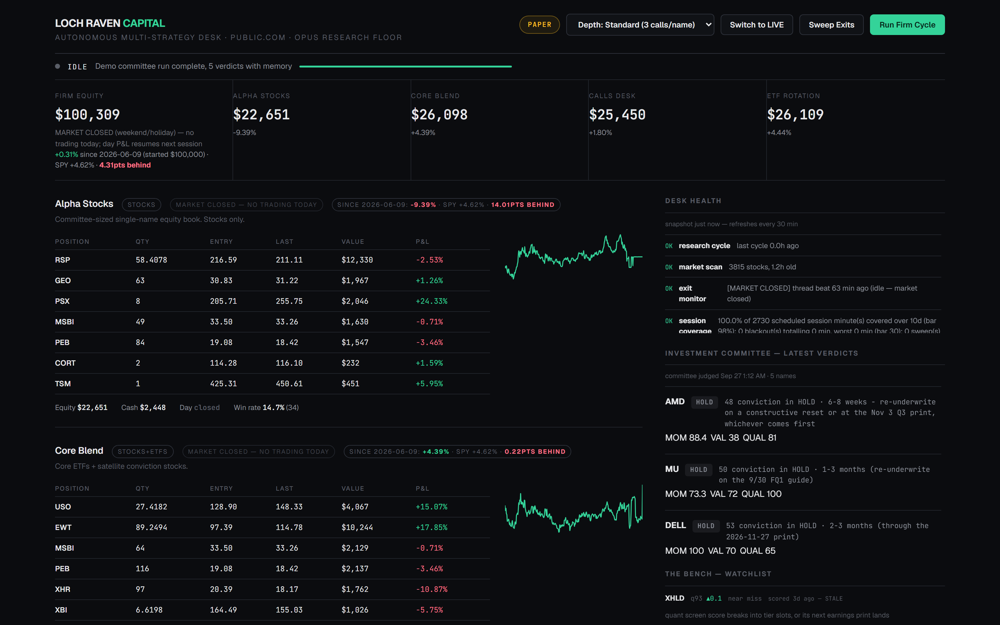
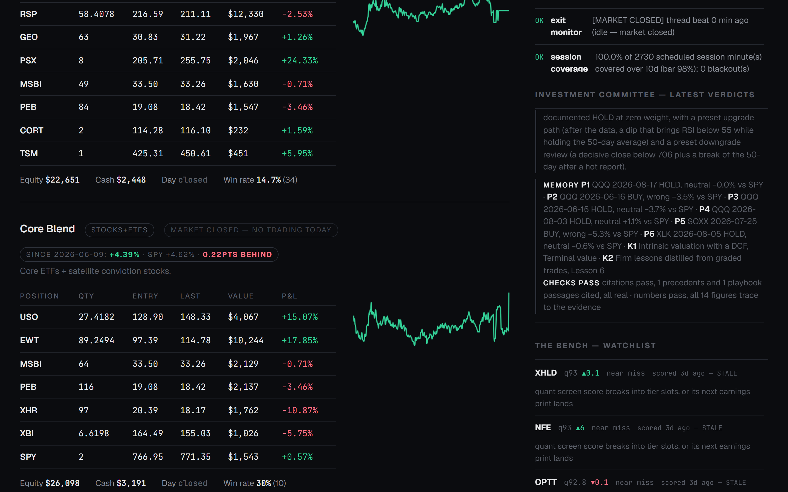

# Loch Raven Capital

An autonomous AI investment committee with an institutional memory.

Built by Patrick Kamdem (Morgan State University) for the **T. Rowe Price NextGen Finance Innovation Challenge at hackUMBC 2026**.

**Demo video** https://youtu.be/5K8J_H19AIA · **Devpost** https://devpost.com/software/loch-raven-capital · **Pitch deck** [`docs/Loch_Raven_Capital_pitch_deck.pdf`](docs/Loch_Raven_Capital_pitch_deck.pdf)



## Research integrity upgrade (October 2026)

The research layer now includes a source-linked seed corpus, live SEC/FRED/price
collection, desk-specific retrieval, provenance hashes, and strict historical
index fitting. See [`docs/RESEARCH_UPGRADE.md`](docs/RESEARCH_UPGRADE.md) for the
source inventory, refresh operation, evaluation scope, and limitations.

```bash
python -m scripts.refresh_research
python -m scripts.evaluate_research
python -m unittest discover -s tests -p 'test_research*.py'
```

The retrieval evaluation measures whether source evidence reaches the right
desk. It is **not a test of portfolio outperformance or a trained new model**.
The older performance tables below describe the original hackathon engine and
must not be read as the upgraded system's measured investment performance.

## The problem

Investment firms are putting AI into their research. On September 10, 2026 T. Rowe Price announced it is expanding Claude across its investment organization. The hard question is not whether an AI can write a research note. It is how anyone knows the AI was right.

Most AI tools answer from generic memory, cannot show their sources and are never graded against what the market did next. Loch Raven measured its own AI committee. Across 1,794 real decisions since June 2026, its buy and sell calls were right only 41% of the time over the following 20 trading days, measured against the S&P 500. Confident is not the same as right.

## What Loch Raven is

Loch Raven Capital is an AI investment firm that runs on one computer. Every morning it screens the whole US stock market, five Claude research desks study the best candidates, a bull, a bear and a base case argue, a portfolio manager agent issues a binding verdict, and a risk desk with hard limits decides what the firm may do. Four strategy sleeves trade a paper book. See `docs/ENGINE.md` for the full engine.

The Institutional Memory built at hackUMBC runs in the background of that flow. The cockpit looks exactly as it did before. The difference is inside every committee decision. Before the judge rules, it retrieves the firm's most relevant graded past decisions and playbook pages, cites them as P and K numbers, and the verdict records what it was shown and whether its citations and numbers checked out. Open any verdict in the cockpit to see its memory line.



The committee run of September 27, 2026, made with the memory switched on. QQQ, an ETF, held at 45 instead of chasing its rally. It cited P2, the firm's own June 16 buy of QQQ on the same setup, which lost 3.5% against the S&P 500 over the next 20 trading days, and K2, firm lesson 6, which halves momentum credit. The checks confirm that every citation points at something the judge was shown and that all 14 figures trace to the evidence.

## What was built at hackUMBC 2026

The hackUMBC rules ask that submitted work happen during the hacking period, from 12 PM Saturday September 26 to 11:45 AM Sunday September 27, 2026. Here is exactly what existed before and what was built during it.

* **Before the event.** The trading engine above, built and run from June to September 2026, is imported unchanged in the first commit (`35f7903`) except for removing personal paths and contact details.
* **During the event.** Everything in every later commit. That is the Institutional Memory layer below, its console, its tests and this documentation.

| Built at hackUMBC | File |
| --- | --- |
| Archive of 1,794 graded committee decisions | `data/memory/memos.jsonl`, `scripts/build_memory_dataset.py`, `firm/memory_archive.py` |
| Firm playbook of 9 methodology chapters and 12 lessons | `data/memory/playbook/`, `data/memory/lessons.md` |
| Point in time hybrid retrieval (RAG) | `firm/memory_rag.py` |
| Guardrails and a hash chained audit log | `firm/memory_guard.py` |
| Memory grounded Claude review | `firm/memory_review.py` |
| Walk forward evaluation | `firm/memory_eval.py` |
| RAFT fine tuning datasets | `firm/memory_finetune.py` |
| Console and API | `memory_console.py`, `firm/memory_api.py`, `dashboard/memory.html` |
| Precedents and playbook pages in every committee judge prompt | `firm/debate.py` |
| Memory line and checks on every verdict in the cockpit | `firm/debate.py`, `dashboard/index.html` |
| Demo isolation mode to run a paper copy beside a live firm | `config.py`, `scripts/seed_demo_state.py`, `scripts/export_demo_state.py` |
| Overnight committee run with memory on, five verdicts, snapshot for offline viewing | `scripts/demo_committee_run.py`, `data/demo_state/` |
| 64 check memory test suite | `tests/test_memory.py` |

## Quick start, offline, no keys

```bash
git clone https://github.com/PadiusD1/loch-raven-capital
cd loch-raven-capital
python -m pip install -r requirements.txt
python memory_console.py
```

Open http://localhost:8421/memory and click AMD, MU, CSCO or QQQ. Those four reviews are real Claude answers recorded tonight. The console replays them offline and reruns every guardrail live.

For a live review, sign in to the Claude Code CLI (`claude`) and switch the console to Live Claude. The full firm cockpit runs with `python app.py` on port 8420 and mounts the same memory routes.

## Open the populated cockpit

The cockpit in the screenshot is a paper copy of the firm holding the committee run of September 27, 2026, made with the memory switched on. To open it offline, seed a local state folder from the snapshot in `data/demo_state`.

```bash
python scripts/seed_demo_state.py --source data/demo_state
```

Then start the app in demo mode. On Windows PowerShell

```powershell
$env:LOCH_RAVEN_DEMO = "1"; $env:LOCH_RAVEN_PORT = "8430"; python app.py
```

On macOS or Linux

```bash
LOCH_RAVEN_DEMO=1 LOCH_RAVEN_PORT=8430 python app.py
```

Open http://localhost:8430 and click any verdict dated September 27. Its memory line lists the P and K sources the judge was shown and whether its citations and numbers checked out. The memory console is at http://localhost:8430/memory. Demo mode blanks the broker credentials, so it can only ever trade paper.

## How the memory works

**Two kinds of institutional memory.** The playbook holds how the firm analyzes. Its nine chapters cover financial statements, thesis and due diligence, modeling, multiples, DCF, research writing, evidence on extreme winners and the firm risk policy, plus the 12 lessons the firm distilled from its own graded trades. The history holds what the firm decided and what the market did next. Every memo carries its outcome 5 and 20 trading days later versus SPY, and the date that outcome became knowable.

**Retrieval.** Every document is indexed twice. BM25 catches exact language such as tickers, catalysts and metric names. TF-IDF cosine on words and bigrams supplies a second lexical ranker. Both rankers are refit on historically eligible text; this is not a neural embedding model. The two rankings are fused with reciprocal rank fusion. A per ticker cap keeps results diverse, and a source quota puts at least one methodology passage in every review.

**Point in time.** A decision dated D only sees memos written before D, and only sees outcomes that were already knowable before D. This is enforced in the retriever, checked again by the guardrails and tested in the suite.

**Grounded answers.** Claude receives the playbook passages as `[K1]` to `[K3]` and the precedents as `[P1]` to `[P6]`, and must cite what it relies on.

**Guardrails the model cannot override.** Every answer is checked for real citations, figures that trace back to the evidence, no look ahead and firm policy limits, and every answer is a recommendation that a human signs off. Each review is appended to a hash chained audit log, so editing any past record breaks the chain.

**Fine tuning data, the careful way.** `firm/memory_finetune.py` exports supervised examples (only calls the market proved right), KTO examples (every graded call labeled desirable or undesirable) and reward labels. Prompts follow the RAFT recipe (retrieval augmented fine tuning), so each example carries the playbook passages and point in time precedents the committee could have retrieved that day. Training rows were all graded before the split date and test rows were all decided after it, with zero leaked rows.

## Honest results

Walk forward over every graded buy and sell call, each call seeing only what was knowable on its own date.

| Group | Calls | Right | Average versus SPY |
| --- | --- | --- | --- |
| Committee alone | 264 | 41% | minus 3.1 points |
| Memory supported the call | 73 | 32% | minus 5.0 points |
| Memory warned against the call | 145 | 45% | minus 3.2 points |
| Conviction 60 to 69 | 188 | 37% | minus 4.6 points |

The memory retrieves six precedents, the same number the live committee sees. Across retrieval depths from 5 to 12, calls the memory supported were right 32% to 41% of the time and calls it warned against 40% to 45%. In no setting did following the memory clearly beat ignoring it, and at 218 calls none of these gaps is statistically significant. Momentum reversed in July, so setups that had worked in June stopped working. The memory therefore informs the committee and never overrules it.

It did surface a real flaw. Most calls sat at 60 to 69 conviction and were right only 37% of the time, the same weakness the firm's own review flagged on September 18, which is now retrieved and cited at every decision.

## The four sleeves and the $100k paper book

The AI team runs a $100,000 paper book split across four categories, $25,000 each at launch on June 9, 2026. Alpha Stocks is a committee sized single stock book. Core Blend holds a 55% ETF core whose seats are earned by momentum plus 45% conviction satellites. The Options Desk trades long calls and puts only, with exit ladders designed per trade by an AI exit strategist. ETF Rotation holds the top 3 of 17 ETFs by momentum and moves to T bills when nothing beats cash.

The team allocates on its own. The portfolio manager sizes every position from its conviction, the risk desk caps any name at 18% of a sleeve and any sector at 35%, a weekly rebalance moves idle cash when a sleeve drifts outside 12% to 40% of the firm, and the learning review retunes caps inside hard bounds.

At the September 25, 2026 close the book stood at $100,309 against a 4.6% gain for the S&P 500 since June 9. ETF Rotation ($26,109) and Core Blend ($26,098) tracked the index, the Options Desk ($25,450) trailed it, and Alpha Stocks ($22,651), the sleeve that leans hardest on AI judgment, lagged it by 14 points. That gap is why the memory layer exists.

The October upgrade removes the original future-vocabulary limitation: both rankers are now fitted on text available before each replayed decision. Archived performance tables above have not been replaced with claims of a new investment edge.

Four months and one market regime make a starter archive. The same pipeline pointed at a firm with decades of graded research is where these statistics become meaningful.

## Responsible by design

* Paper trading by default. Live trading needs an explicit switch and is refused while positions or orders are open.
* Position caps of 18% per name and 35% per sector, volatility aware stops, a daily circuit breaker, a soft tier that halves new sizes, and a kill switch that diagnoses sector, market or stock picking failure before it halts.
* Memory reviews never place orders.
* Every review is written to a tamper evident audit chain.

## Tests

```bash
python tests/test_memory.py      # 64 checks, the memory layer
python tests/test_firm.py        # 1,104 checks, the trading engine
python tests/test_week_sim.py    # 53 checks, a simulated trading week plus live mode plumbing
```

## Repository map

* `firm/` the engine and the memory layer (`memory_*.py`)
* `data/memory/` the archive, prices, playbook and recorded demo reviews
* `dashboard/` the cockpit (`index.html`) and the memory console (`memory.html`)
* `tests/` the regression suites
* `docs/` the engine documentation and audit history

## Sources and credits

* Playbook chapters are written in our own words from the author's Wall Street Prep Sell Side Equity Research Certification notes and a Morgan State University DCF lesson series (April 2026). No course text is reproduced.
* Chapter 8 summarizes Anna Yartseva, The Alchemy of Multibagger Stocks, CAFE working paper 33, Birmingham City University, 2025 (CC BY NC SA).
* T. Rowe Price facts come from its press release of September 10, 2026.
* Research and reviews run on Claude through the Claude Code CLI. Built with FastAPI, scikit learn, NumPy and yfinance.

Nothing here is investment advice. Past results do not promise future results.

Copyright 2026 Patrick Kamdem. All rights reserved.
